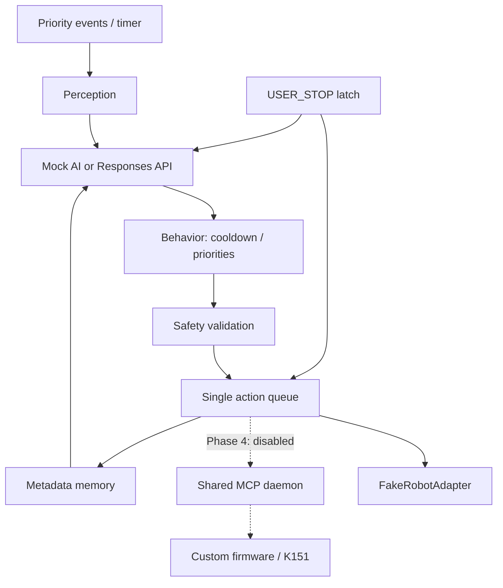

# Architecture

독립 Python 프로세스의 Phase 0–3 MVP다. 기본 경로는 전부 로컬 Mock이며,
공식/커스텀 펌웨어나 공유 게이트웨이를 기동하거나 변경하지 않는다.

| 책임 | 모듈 / 인터페이스 |
|---|---|
| Perception | perception.Perception.process, ports.RobotAdapter.capture |
| AI Decision | decision.MockDecisionProvider / OpenAIDecisionProvider; ports.DecisionProvider |
| Behavior | engine.EventQueue, AutonomyEngine.step의 상황 변화·발화 cooldown 선택 |
| Memory | memory.Memory, 제한된 MemoryRecord, SQLite 선택 |
| Action | action.ActionExecutor.execute, 단일 consumer, 실제 로봇 실행 금지 |
| Safety | safety.SafetyPolicy.plan / RequestBudget, typed Decision |

BOOT → IDLE → OBSERVE → THINK → VALIDATE → ACT → COOLDOWN → IDLE.
변화 없음/쿨다운/유효하지 않은 결정은 행동을 생략한다. STOPPED는 수동 재시작까지
유지한다. 장치 장애는 ERROR로 동작을 차단하며 자동 재연결·재전송하지 않는다.
클라우드 오류는 안전한 idle로 복귀한다. 상태 기록과 이벤트/명령 큐는 유한하다.

## 동시성과 중지

엔진 cycle lock과 단일 action consumer를 분리했다. 지연된 명령은 queue 내부에서
최신 pose를 읽고 검증한다. STOP은 큐가 가득 차도 동기 latch를 먼저 설정하며
현재 AI/cycle/command를 취소하고 대기 명령을 폐기한다. 새 명령을 보내지 않는다.
이것은 **소프트웨어 차단**이다. 이미 전송된 명령·외부 클라이언트·장치의 자체 애니메이션을
물리적으로 멈추거나 토크를 제거하는 기능으로 설명하지 않는다.

기본적으로 복합 행동은 거부한다. idle/look/emote/speak 외 도구 선택,
임의 코드, 셸, 파일 접근, 펌웨어 업데이트는 AI 출력 계약에 없다.
중복·빈도 초과 명령은 지연 실행하지 않고 버린다. ACK가 불명확한 장애 후
같은 executor에서 재실행하지 않는다.

## 관찰과 개인정보

30초 주기의 scheduler와 별도로 즉시 실행하는 bounded demo CLI가 있다.
로컬 16×16 grayscale signature의 평균 변화량으로 정기 관찰의 불필요한 AI 호출을
줄인다. 이는 물체/사람 인식기가 아니다.
시그니처가 같더라도 300초 후 재분석하고, 분석 장애 후에는 다음 관찰에서 재시도한다.
명시적 사용자 이벤트는 사람 감지 파생 이벤트로 덮어쓰지 않는다.
FakeRobot의 person_present는 명시적인
시뮬레이션 라벨이다. 실제 사람 인식은 승인된 이미지 입력 모델/CV가 필요하다.
Mock 이미지·원시 음성은 파일로 저장하지 않으며 이미지 원본은 cycle 종료 후 해제한다.
Memory는 시간/event kind/intent/result와 typed 발화 설정·마지막 관찰 상태만 저장한다.
기본 persistence는 꺼져 있다. memory_store는 version1 마이그레이션/원자적 SQLite를
관리하며, 자원별 이력/TTL과 독립 발화 시각을 유지한다. [메모리 계약](MEMORY.md) 참고.

클라우드 모드는 명시적인 cloud_enabled와 계정 모델·키가 필요하다. image_transmission은
별도 opt-in이다. 음성 bytes는 명시적 OpenAI audio 어댑터에서만 전송하며
audio_transmission을 켜도 실제 마이크를 시작하지 않는다. 실제 마이크 구현은 없고,
voice-sim은 메모리 내 무음과 fixture 전사문만 사용한다.
Responses는 store=false, strict JSON Schema, SDK 자동 retry 없음이다.
요청 실패도 sliding budget에 포함한다. budget.SQLiteRequestBudget는 요청 전 예약을
공용 SQLite에 원자적으로 기록하므로 한도·집계 메타데이터가 재시작 후에도 유지된다.
provider.usage는 현재 프로세스, budget.snapshot()은 공유 누적 통계다.
실제 청구액·계정 전체 사용량 제한은 아니다.

control.ControlLease와 state_store.SQLiteState는 로컬 DB의 owner/generation/만료 시각을
사용한다. ActionExecutor는 TTL/3 heartbeat와 송신 직전 확인을 수행하고 제어권 소실 시
엔진을 ERROR로 종료한다. aclose는 태스크 정리 후 조건부 release한다.
CLI는 제어권 경합/저장소 오류 시 외부 명령 없이 종료 코드 2를 반환한다.
동일 절대 DB 경로·resource·namespace/한도를 쓰는 참여 프로세스끼리만 적용된다.
DB 실패 시 새 제어/클라우드 호출을 허용하지 않는다. [운영 계약](COORDINATION.md)을 따른다.

## 확장 지점

ports.py의 VoiceInput/PlaybackAdapter/Microphone/SpeechTranscriber/SpeechSynthesizer는
voice.py에서 오프라인 구현과 연결을 제공한다. RecordedVoiceInput은 수동 요청으로만
시작하며 SpeakingRobotAdapter가 기존 ActionExecutor의 speak를 합성/정규화/가상 재생으로
변환한다. stop_event는 STOP뿐 아니라 모든 terminal fault에서 설정해 녹음 작업도 정리한다.
오디오 변환은 bounded PCM/WAV와 선택적인 시스템 libopus를 쓰고 cloud_audio.py는
동의·명시적 모델/voice·공유 예산 아래 SDK를 호출한다. voice-sim CLI는 항상 Fake ASR/TTS다.
실제 마이크·스피커 및 gateway /pcm transport/auth는 아직 차단된다. 상세는 VOICE.md를 따른다.
MCPRobotAdapter는 공유 daemon의 연결/도구 discovery, 상태·절대 pose·터치 파싱을 제공한다.
available은 코드에서 확인한 도구·스키마의 교집합이며 실제 기계 동작 검증을 뜻하지 않는다.
사진 보관/전사 로그/샘플레이트·단일 제어 소유권을 해결하기 전 물리 capture/execute와
blink/LED/listen은 차단된다. simulation.simulate_mcp_robot는 원격 입력 없이 메모리 내
서버/세션을 생성하고 simulation 전용 adapter만 제공한다. CLI의 mcp-sim 모드는
공식 MCP SDK 세션을 통해 전체 engine을 구동하며 실제 gateway/네트워크/장치를 사용하지 않는다.

어댑터는 작업마다 도구 schema를 재확인하며 실제 pose를 읽어 중립 추정을 피한다.
양자화 전후 범위와 slew를 재검사하고, ACK 및 작업 전후 device/session을 확인한다.
알 수 없는 응답/연결/세션 교체/취소/timeout은 재전송 없이 fault로 잠근다.
모터 ACK의 servo_init_ok는 초기화 상태이며 이동 완료나 정상 토크의 증거가 아니다.
전체 ACK의 수치 타입/범위 및 필요한 축의 motion_started를 검증해 모호한 결과는 fault로
처리한다. client 취소/timeout은 이미 전송한 원격 작업의 취소나 rollback을 보장하지 않는다.
한 번 보낸 요청이 나중에 실행되는 경우에도 후속 요청/재전송은 차단한다.
사진은 inline JPEG만 받고 반환된 경로를 읽지 않는다. 센서 available=false는
유령 터치 이벤트를 생성하지 않는다. 어댑터 내부 직렬화에 더해 공용 DB를 쓰는 프로세스
사이에 lease를 적용한다. 외부 제어자와 장치 자체 애니메이션의 gateway 차원 독점 제어는
별도 구현 대상이다. 로컬 generation은 원격 fencing이나 물리적 비상정지를 뜻하지 않는다.

Phase 4–5의 실제 연결 및 승인 순서는 NEXT_STEPS.md를 따른다.
