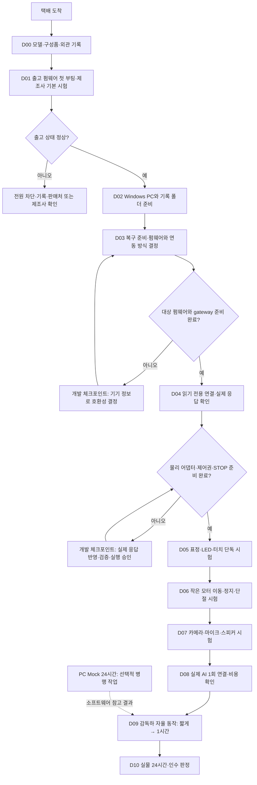

# StackChan 제품 도착 후 작업설명서

대상: **M5Stack StackChan K151 / K151-R**, Windows 노트북, 이 저장소의 자율 엔진.
작성·공식 문서 확인: **2026-11-06**. 실제 배송 제품의 모델과 개정판은 아직 미확인이다.

택배가 오면 **D00부터 순서대로** 진행한다. PC에서 하던 Mock 24시간 시험이 끝나지
않았어도 개봉과 출고 기능 점검은 시작할 수 있다. 처음에는 제품을 개조하지 않는다.

**현재 도달 가능한 지점:** 출고 상태 점검과 PC 시뮬레이션. 호환 펌웨어/gateway가 준비되면
읽기 전용 연결을 시험할 수 있다. **우리 앱이 실제 장치를 움직이거나 촬영·녹음·발성하는
부분은 아직 차단돼 있다.** D04의 개발 체크포인트를 통과해야 D05 이후로 갈 수 있다.
`.env`에서 hardware 값을 바꾸는 것으로 해결되지 않으며 `--mode hardware` 명령도 없다.

## 작업 순서도



| 단계 | 누가 하는가 | 통과하면 남는 것 |
|---|---|---|
| D00–D02 | 사용자: 개봉·화면 확인·PC 명령 | 제품 정보, 출고 점검, PC 실행 기록 |
| D03–D04 | 사용자: 장치 연결 / 개발 담당: 호환성·응답 검토 | 복구 계획, 읽기 전용 연결 결과 |
| D05–D08 | 개발 담당: 미구현 연결 개발 / 사용자: 승인한 실물 시험 | 장치별 어댑터와 실제 시험 기록 |
| D09–D10 | 사용자: 현장 운용 / 개발 담당: 기록 분석·수정 | 1시간·24시간 운용 결과와 인수 판정 |

각 단계는 **PASS / FAIL / HOLD(조건 미충족) / 미실행**으로 기록한다. HOLD에서 다음
실물 시험으로 넘어가지 않는다. 기능을 쓰지 않기로 했다면 이유와 함께 N/A로 남긴다.

## D00. 택배 수령·모델 확인

**준비:** 주문 내역, 포장 라벨, 동봉 설명서, 넓고 평평한 책상. 아직 전원을 넣지 않는다.

1. 주문 내역과 포장의 제품명/SKU를 비교한다. K151 본체인지, K151-R 리모컨 포함
   구성인지 확인한다. 다른 제품이면 이 설명서의 펌웨어 절차를 진행하지 않는다.
2. 본체, USB-C 케이블, 동봉 설명서와 주문한 구성품을 확인한다. 공식 목록에는
   케이블·공구·스티커 등이 있고 리모컨/가방·상자는 번들에 따라 달라질 수 있다.
   빠진 물건은 실제 주문 구성과 먼저 비교한다.
3. 화면 깨짐, 느슨한 부품, 파손, 젖음, 배터리 부풀음·이상한 냄새를 살핀다.
   이상이 있으면 전원을 연결하지 말고 판매처에 확인한다.
4. 바닥·측면의 표시를 보고 원래 StackChan 컨트롤러인지, 교체된 CoreS3 계열인지
   기록한다. 외형만 보고 내부 보드나 LCD 드라이버를 확정하지 않는다. 분해하지 않는다.
5. 모터로 연결된 머리와 몸체를 손으로 억지로 돌리지 않는다. 공식 문서도 전원/제어 상태를
   모를 때 수동 회전을 금지한다.

**통과 기준:** 주문 제품과 일치하고 외관 이상이 없다. 모델/번들/확인 가능한 개정 정보가
기록됐다. 시리얼·MAC 전체, 계정 QR은 공개 GitHub나 채팅 사진에서 가린다.

## D01. 출고 상태로 첫 부팅·기본 기능 확인

이 단계는 **제조사 제품의 정상 여부**를 확인한다. 우리 자율 엔진의 성공 판정과 별개다.
공식 출고 화면은 버전에 따라 달라질 수 있으므로 동봉 설명서와 실제 화면을 우선 대조한다.

### 1) 움직임·전원 준비

1. 책상 가장자리를 피하고 머리가 좌우·위로 움직여도 손·물건·케이블과 부딪히지 않게 한다.
   USB 케이블은 팽팽하게 당겨지거나 회전부에 감기지 않게 둔다. 리모컨은 꺼 둔다.
2. 충전기/전원은 동봉 설명서·기기 표기에 맞는 정상 제품을 사용한다. 임의 전압을 넣지 않는다.
   우선 **베이스 USB-C 포트**를 쓴다. 공식 문서는 두 포트 모두 데이터 통신이 가능하나
   움직임 사고를 줄이기 위해 베이스 포트를 권장한다.
3. 전원 버튼 위치부터 확인한다. 공식 안내상 왼쪽 USB-C 옆 버튼은 **한 번 누르면 켜짐,
   길게 누르면 꺼짐**이다. 바닥 microSD 옆 **RST 한 번은 재부팅**이다.
   RST는 비상정지 버튼이 아니다. USB를 뽑아도 내장 배터리로 계속 켜져 있을 수 있다.
4. 연결/전원 켜기 후 화면을 확인한다. 자동 동작이 생길 수 있으므로 손을 회전부에서 뗀다.

### 2) 제조사 첫 부팅 서보 시험

공식 초기 안내는 Welcome → **Start → 안정된 바닥에 놓고 손을 뗌 → Start**이다.
두 번째 Start를 누르면 **실제 서보가 좌·우·위로 움직이고 처음 자세로 돌아온다.**
주변과 케이블을 다시 확인하고 이 움직임을 관찰할 준비가 됐을 때만 누른다.

**관찰:** 화면이 켜지는지, 제조사가 안내한 움직임 후 돌아오는지, 걸림·지속적인
떨림·이상음·케이블 당김이 없는지 확인한다. 이상하면 반복 시험하지 말고 전원을 끈다.
이미 설정된 제품에서 Welcome이 없으면 출고 버전을 기록하고 해당 화면의 안내를 따른다.
검사를 위해 초기화·보정 메뉴를 무작정 누르지 않는다.

### 3) 출고 앱 연결

계정 등록과 Wi-Fi 설정을 진행할 경우 공식 [제품 안내][m5-product]의 링크에서
**StackChan World**를 설치한다. 공식 안내에는 Android/iOS 링크가 있다.

1. M5Stack 계정으로 로그인/가입한다. 이 계정은 우리 앱의 OpenAI API 키와 별개다.
2. 서보 시험 후 Next → Next, 휴대전화 앱에서 **Add a new StackChan**을 선택한다.
3. 화면에 표시된 ID와 일치하는 기기를 선택한다. 앱의 Bluetooth 등 필요한 권한을 허용한다.
4. 이름·대화 언어·AI Agent/음성 설정·Wi-Fi를 화면 안내대로 정한다. **2.4GHz Wi-Fi**가
   필요하다. 5GHz와 웹 로그인 창이 필요한 회사/호텔 Wi-Fi는 지원하지 않는다.
5. 설정 완료 후 재부팅과 연결 상태를 확인한다. 회사 Wi-Fi에 임의 등록하지 말고
   사용 가능한 개인 네트워크를 이용한다. 비밀번호·로그인 QR을 기록 양식에 옮기지 않는다.

현재 공식 문서는 원래 StackChan 컨트롤러를 대상으로 앱 연결을 설명한다. 일반 CoreS3,
CoreS3-SE/Lite로 교체된 제품은 출고 앱과 호환된다고 추정하지 않는다.

### 4) 기본 점검과 종료

- 화면/메뉴 이동, 배터리·네트워크 표시와 표시된 펌웨어 버전을 기록한다.
- Setup에 RGB LED Test/Microphone Test가 실제로 있으면 하나씩 확인한다.
  MicTest의 반응은 센서 점검이며 한국어 인식 성공을 뜻하지 않는다.
- Servo Test/보정/Move To Home은 모터를 구동한다. 첫 시험에 이상이 있으면
  반복·수동 보정하지 않는다. 제조사 보정은 별도 진단 절차로 남긴다.
- 출고 AI 대화를 원하면 서비스의 음성 전송·보관 조건을 확인한 뒤 시도한다.
  **AI Agent에 들어가면 OTA를 자동 확인·설치하고 재부팅할 수 있다.** 먼저 버전을 적고,
  뜻하지 않은 업데이트를 피하려면 이 메뉴 진입을 미룬다. 로컬 기본 시험에 필수는 아니다.
- 출고 AI를 사용한 경우 초록 LED는 듣기, 파랑은 말하기, 꺼짐은 대기라는 공식 안내와
  비교한다. 출고 대화 성공을 우리 앱의 STT/TTS 성공으로 기록하지 않는다.
- 전원 버튼을 길게 눌러 꺼짐을 확인한다. 화면·LED·움직임과 배터리 전원 상태를 함께 확인한다.

**통과 기준:** 출고 첫 부팅/기본 점검에 이상이 없고 버전과 전원 차단 방법이 기록됐다.
앱/클라우드 사용을 미룬 항목은 미실행으로 남긴다. 이상이 있으면 **D03 플래시보다
판매처/제조사 확인이 먼저**다. 초기불량 증거를 남기기 전에 펌웨어를 덮어쓰지 않는다.

## D02. Windows 노트북 준비·기록 폴더 만들기

관리자 PowerShell이나 `C:\Windows\System32` 작업 폴더는 필요하지 않다. 개인 노트북의
사용자 폴더를 사용한다. 회사 PC에서 시작한 시험은 Ctrl+C로 종료할 수 있고 이어하기는 없다.

### 새 PC에 설치하는 경우

Git이 없으면 [Git for Windows](https://git-scm.com/download/win)를 설치하고 PowerShell을
다시 연다. `winget`은 이 절차에 필요하지 않다. 아래는 **위에서부터 한 줄씩** 실행한다.

```powershell
cd $env:USERPROFILE
git --version
Invoke-RestMethod https://astral.sh/uv/install.ps1 | Invoke-Expression
$env:Path = "$env:USERPROFILE\.local\bin;$env:Path"
uv --version
git clone --branch feat/transport-soak https://github.com/rownlvh8875-coder/stackchan-autonomy.git stackchan-soak-24h
cd stackchan-soak-24h
uv python install 3.12
uv sync --frozen --python 3.12
```

uv 설치 명령은 [Astral 공식 설치 안내][uv-install]의 PowerShell 명령이다. 회사 보안 정책이
막으면 보안 설정/실행 정책을 우회하지 말고 개인 PC를 쓴다. 설치가 실패한 줄에서 멈춘다.
개인 PC에서도 execution policy 오류가 나면 [공식 uv 릴리스](https://github.com/astral-sh/uv/releases)에서
CPU에 맞는 Windows ZIP을 받아 사용자 폴더의 `.local\bin`에 압축을 푸는 방법을 사용할 수 있다.
이 경로는 설치 스크립트 실행 정책을 바꾸지 않는다. 다음 단계 전에 `uv --version`을 확인한다.

### 이미 `stackchan-soak-24h` 폴더가 있는 경우

재복제/삭제하지 않는다. 실행 중인 시험이 있으면 먼저 끝내거나 Ctrl+C로 종료한 뒤 확인한다.

```powershell
cd "$env:USERPROFILE\stackchan-soak-24h"
$env:Path = "$env:USERPROFILE\.local\bin;$env:Path"
uv --version
git status --short --branch
git branch --show-current
```

브랜치가 `feat/transport-soak`이고 수정 파일이 없을 때만 `git pull --ff-only`로 갱신한다.
다른 브랜치/수정 파일이 있거나 pull이 실패하면 reset·강제 checkout을 하지 말고 결과를 확인한다.
이 설명서의 soak 명령은 이 브랜치 기준이며 `main`의 기능과 같다고 가정하지 않는다.

```powershell
git pull --ff-only
uv sync --frozen --python 3.12
git rev-parse HEAD
uv run --frozen stackchan-autonomy --cycles 3 --person
uv run --frozen stackchan-autonomy --mode mcp-sim --cycles 3 --event touch
uv run --frozen stackchan-autonomy --mode voice-sim --cycles 1 --event touch
uv run --frozen stackchan-soak --cycles 30 --warmup-cycles 5 --restart-every 10
```

Mock/MCP/voice 결과의 `mode`·`robot`이 시뮬레이션이고 `cloud_requests`가 0인지 확인한다.
voice-sim은 고정 한국어 전사와 시험용 tone을 사용한다. 실제 녹음/스피커 시험은 아니다.
soak는 `passed: true`, `violations: []`, `cloud_requests: 0`이 기준이다.
기존 `.env`를 덮어쓰지 않는다. 이 단계에 API 키·기기·gateway는 필요 없다.

### 개인 기록 폴더

```powershell
$session = Get-Date -Format "yyyyMMdd-HHmmss"
$recordDir = ".local/device-validation/$session"
New-Item -ItemType Directory -Force -Path $recordDir | Out-Null
Copy-Item docs/templates/DEVICE_ACCEPTANCE_RECORD.ko.md "$recordDir/record.md"
notepad "$recordDir/record.md"
```

새 PowerShell을 열면 `$recordDir` 변수는 사라지므로 기존 폴더 경로를 다시 지정한다.
`.local/`은 Git에서 제외된다. 원본 사진/영상이 필요하면 여기서 관리하고 공유 전 가린다.
**통과 기준:** 세 시뮬레이션과 짧은 soak 성공, 소스 커밋과 실행 PC 정보 기록.

## D03. 복구 준비·펌웨어와 연동 방식 결정

### 1) 우선 현재 상태 보존

펌웨어 버전, 출고 앱 연결 여부, 확인 가능한 보정 설정을 로컬 기록에 남긴다.
공식 앱 전체 설정/NVS를 이 저장소가 자동 백업하는 기능은 없다. 복구 이미지가 있어도
계정·대화·보정값까지 자동 복원된다는 뜻은 아니다.

공식 문서에는 **2026-08-07 LCD가 ILI9342C → ILI9342E로 변경됐고 M5GFX 0.2.27 이상이
필요하다**고 적혀 있다. 주문일만으로 실물 개정판을 확정하지 않는다. 해당 보드/LCD를
지원하는 빌드인지 확인하기 전에는 커스텀 펌웨어를 쓰지 않는다.

### 2) 연결 경로 선택 — 개발 담당과 함께 결정

| 경로 | 현재 용도 | 우리 엔진에 필요한 후속 작업 |
|---|---|---|
| 출고 펌웨어 + StackChan World | 제조사 기본 동작 확인 | 공식 MCP 전송/인증/도구/좌표 조사, 별도 어댑터 검토 |
| 감사한 kisaragi 커스텀 펌웨어 + 별도 gateway | 현재 시뮬레이터가 참고한 계약 | 실물 보드 호환성, 실제 응답, 제어권·매체 정책, 물리 어댑터 개발 |
| Qoder/UiFlow/다른 커스텀 프로젝트 | 별도의 제품/개발 경로 | 이 설명서의 gateway와 호환된다고 가정하지 않음 |

출고 앱의 MCP 설정을 켜거나 USB 케이블을 꽂는 것만으로 PC의
`http://127.0.0.1:8767/mcp`가 생기지 않는다. 감사한 경로는 **장치 펌웨어 ↔ Wi-Fi ↔ PC
gateway ↔ 자율 엔진** 구조다. USB는 전원/플래시에 사용하며 기본 USB 직결 어댑터는 없다.
펌웨어 교체가 꼭 필요한지부터 실제 모델/버전으로 판단한다.

### 3) 복구 도구 준비 — 여기서는 Burn을 누르지 않는다

1. [공식 다운로드][m5-download] 또는 [M5Burner 안내][m5-burner]에서 Windows용을 받는다.
   공식 제품 안내의 **Restore Factory Firmware** 절을 함께 연다.
2. M5Burner에서 `StackChan` 검색 → **Only Official** → 실제 제품에 맞는 공식 항목의
   이름/게시자/버전/대상 보드를 확인 → Download한다. 일반 CoreS3 이미지로 대체하지 않는다.
3. 사용한 다운로드 URL·버전·파일 SHA-256을 로컬 기록에 적는다.
   `Get-FileHash -Algorithm SHA256 "실제 다운로드 파일 경로"`로 계산할 수 있다.
   자체 계산값은 동일 파일 추적용이다. 제조사 서명/공개 체크섬과 대조하지 못했으면
   **출처 확인 / 진위 체크섬 대조 미실행**으로 기록한다.
4. 장치를 베이스 USB-C로 연결하고 Windows 장치 관리자에서 연결 전후 COM 포트 차이를 본다.
   데이터 케이블인지 확인한다. COM이 안 보이면 [장애 대응](#문제가-생기면) 순서로 점검한다.
   CP210x/CH340 등 임의 드라이버를 일괄 설치하지 않는다. 실제 장치 정보와 제조사 안내를 따른다.
5. 복구 이미지와 절차가 준비됐는지 확인한다. **실제 복구 성공은 아직 미검증**으로 남긴다.

### 4) 교체가 필요하다고 결정됐을 때만

개발 담당이 대상 펌웨어의 저장소/고정 커밋, K151·LCD 지원, 설치/되돌리기 절차,
기존 기능·보정·계정에 주는 영향을 정리한다. 사용자가 그 범위의 변경을 승인한 후 진행한다.
범용 `esptool erase_flash` 명령이나 다른 보드 이미지를 추측해 실행하지 않는다.

공식 안내상 출고 World와 다른 XiaoZhi 기반 펌웨어는 계정 체계가 호환되지 않는다.
그 경로로 전환할 때는 **현재 시스템에서 먼저 연결 해제**해야 한다. 반대 방향도 마찬가지다.
연결 해제는 AI 설정·대화 이력을 지우고 앱을 분리한다. 되돌리기용 버튼처럼 누르지 않는다.
다른 펌웨어가 XiaoZhi 계정 경로를 사용하는지도 먼저 확인한다.

공식 복구를 실행하기로 승인한 경우의 제조사 순서는 다음과 같다.

1. 맞는 공식 StackChan 이미지 Download → 베이스 USB-C 연결 → 전원 켜기.
2. **Burn → 연결 전후로 확인한 장치 포트 선택 → Start**. 완료까지 연결/전원을 유지한다.
3. 포트가 안 보일 때의 공식 download mode: 바닥 RST를 약 **3초** 누르고 옆 표시가
   녹색이 되면 놓는다. 일반 재부팅이나 계정 초기화와 다르다. 먼저 케이블/포트를 점검한다.
4. 완료 후 부팅·버전·화면·기본 동작을 다시 확인한다. 설정/계정 재연결이 필요할 수 있다.

**통과 기준:** 실제 보드에 맞는 연동 경로, 복구 계획, 사용할 버전과 변경 승인이 기록됐다.
확인되지 않은 호환성이나 지워질 설정이 있으면 **HOLD**. 개발 담당에게 모델·버전·오류 코드만
공유한다. 플래시는 이번 문서 작성 작업에서 실행하지 않았다.

## D04. gateway 준비와 읽기 전용 연결

**시작 조건:** D03에서 호환 펌웨어와 gateway를 준비했다. 출고 상태 그대로라면 이 조건이
충족됐다고 가정하지 않는다. 아래 명령은 장치/PC 앞에서 준비 완료 후 사용할 예시다.

감사 기준은 kisaragi gateway **0.20.0 / 커밋
`03fbd92774c37844e11ea097e632df28f2a5f4e5`**다. 설치/부팅/네트워크 설정은 해당 버전의
[daemon 안내][gateway-daemon]를 기준으로 개발 담당이 구성한다. gateway는 우리 패키지에
포함돼 있지 않다. 임의 최신 버전으로 바꾸면 계약과 보드 지원을 다시 확인한다.

### 1) 별도 PowerShell 창에서 gateway 1개만 실행

해당 gateway 소스의 **`gateway` 폴더**에서 실행한다. 우리 프로젝트 루트에서 실행하는
명령이 아니다. 이미 daemon이 있으면 재사용하고 두 번째 stdio/daemon을 띄우지 않는다.

```powershell
uv run stackchan-mcp serve --transport streamable-http
```

| 연결 | 감사 버전의 기본값 | 확인할 점 |
|---|---|---|
| 우리 PC 앱 → MCP gateway | `127.0.0.1:8767/mcp` | 같은 PC의 loopback, HTTP 인증 |
| 장치 → PC gateway | WebSocket 8765 | 장치는 PC의 실제 LAN 주소에 접속; 127.0.0.1은 PC 주소가 아님 |
| 장치 → PC capture 서버 | HTTP 8766 | 카메라 사용 전 저장·삭제 정책 해결 |

PC와 장치는 같은 사용 가능한 LAN에 두고 AP의 기기 간 격리 여부를 확인한다.
장치용 WS 주소와 capture의 `VISION_HOST`/`VISION_URL`, `STACKCHAN_TOKEN`은 고정 버전
안내에 맞춰 설정한다. 실제 호스트·인증 동작은 실기 검증 항목이다. 필요한 앱/로컬 서브넷만
방화벽 허용 대상으로 검토하고 방화벽 전체를 끄거나 인터넷 포트포워딩을 하지 않는다.
MCP는 기본 loopback을 유지한다. LAN에 공개할 필요가 생기면 토큰·allowed hosts 등을
별도로 구성한다. Wi-Fi 비밀번호와 토큰을 URL·스크린샷·Git에 넣지 않는다.

### 2) 우리 프로젝트 창에서 읽기만 확인

아래 예시는 현재 공개 Python API의 `connect → discover → status → touch_state`만 사용한다.
표정/LED/모터/촬영/녹음/발성을 호출하지 않는다. **gateway 자체의 자율 동작을 멈추는 코드는
아니므로**, 다른 제어 앱·추적·댄스·자동 서보 애니메이션은 별도로 비활성화한다.

gateway에 토큰을 설정했다면 이 창에도 같은 값을 안전하게 제공한다. 예시가 읽는 환경변수
이름은 `STACKCHAN_TOKEN`이다. `.env`가 자동으로 읽힌다고 가정하지 않는다. 토큰 값을
콘솔 기록에 남기는 입력 예시는 제공하지 않는다. 필요하면 개발 담당과 보안 입력을 준비한다.

```powershell
cd "$env:USERPROFILE\stackchan-soak-24h"
$env:Path = "$env:USERPROFILE\.local\bin;$env:Path"
@'
import asyncio
import json
import os

from stackchan_autonomy.mcp_robot import MCPRobotAdapter


async def main():
    token = os.environ.get("STACKCHAN_TOKEN")
    headers = {"Authorization": f"Bearer {token}"} if token else None
    async with MCPRobotAdapter.connect(
        "http://127.0.0.1:8767/mcp", headers=headers, timeout_s=10
    ) as robot:
        report = await robot.discover()
        if not report.connected:
            raise RuntimeError("read-only discovery failed")
        print(json.dumps(report.model_dump(mode="json"), ensure_ascii=False))
        status = await robot.status()
        print(json.dumps(status.model_dump(mode="json"), ensure_ascii=False))
        if "touch" in report.available:
            print("Touch test: gently touch the top panel during the next 10 seconds.")
            for _ in range(10):
                touch = await robot.touch_state()
                print(json.dumps(touch.model_dump(mode="json") if touch else None))
                await asyncio.sleep(1)
        else:
            print("HOLD: touch capability unavailable")


try:
    asyncio.run(main())
except KeyboardInterrupt:
    raise SystemExit(130)
except Exception:
    print("READ_ONLY_CHECK_FAILED: inspect firmware, gateway and session locally.")
    raise SystemExit(2)
'@ | uv run --frozen python -
```

위의 `@'`와 `'@`는 PowerShell에서 여러 줄 문자열의 시작과 끝을 표시한다. 마지막 `'@` 앞에
공백을 추가하지 않는다. 실행이 실패하면 출력 원문에 비밀값이 없는지 확인하고 고정 오류
코드와 버전만 공유한다. 원시 gateway 디버그 로그를 통째로 올리지 않는다.

**통과 기준:** 연결/초기화된 장치와 세션이 안정적으로 유지되고 실제 절대 각도가 읽힌다.
터치 기능을 사용할 계획이면 실제 터치/해제와 반환 영역·이벤트가 맞는지도 확인한다.
`available`은 도구 계약 확인 결과이며 물리 실행 허가가 아니다.
`physical_execution_enabled`는 이 버전에서 **false가 정상**이다.
장치/세션 식별자는 공개하지 말고 로컬에서 확인한다.

각도가 현재 파서 범위와 다르거나 `get_status`/`get_head_angles` 계약이 다르면 **HOLD**.
출고 펌웨어 좌표를 커스텀 좌표로 간주하거나 파서 검사를 약화하지 않는다.
시간초과/세션 변경 후에는 자동 재시도하지 않는다. 원인을 확인하고 새 세션으로 수동 재검사한다.
MCP 세션 종료/DELETE와 실제 모터 정지는 서로 다른 결과다.

### 개발 체크포인트 — 여기서 바로 자율 실행할 수는 없다

개발 담당에게 장치 모델/버전, 개인정보를 제거한 도구 스키마·상태/각도/터치 응답을 전달한다.
현재 구현은 [MCPRobotAdapter](../src/stackchan_autonomy/mcp_robot.py)와
[실물 후속 과제](NEXT_STEPS.md)에 있다. 다음을 구현·검증하고 사용 명령을 새로 확정해야 한다.

- 선택한 실물의 응답/ACK/각도 단위를 반영한 어댑터와 개별 기능 활성화 경로.
- 장치 자체 동작·다른 앱·다른 PC까지 포함하는 제어권 확보. 앱 내부 SQLite lease만으로는 부족하다.
- STOP/timeout/명령 ACK 유실/통신 단절 때 재전송 금지와 수동 복구.
- 세션·기기 변경 시 차단, 실제 피드백 확인, 매체 기능의 독립적 동의/보관 제어.
- Mock/계약 회귀 검증 후 사용자가 승인한 범위의 실물 단독 시험 명령.

**이후 D05–D10은 실물 인수 절차다. 아직 없는 실행 명령을 채워 넣은 상태가 아니다.**
개발이 끝나면 해당 커밋/실행 명령을 기록 양식에 추가하고 단계별로 실행한다.

## D05. 표정·LED·터치 단독 시험

**시작 조건:** 위 개발 체크포인트 통과, 실행 커밋/명령 확정, 모터 제어는 비활성 상태.

1. 표정 1개를 요청하고 화면 변화와 ACK/오류를 함께 확인한다. 다음 표정은 확인 후 보낸다.
2. blink를 켜고 끄며 실제 동작을 비교한다. 표정 변경으로 자동 모터 동작이 생기면 중단한다.
3. 낮은 밝기의 LED 한 색부터 확인하고 끈다. `available=false`나 PY32 오류는 성공으로 세지 않는다.
4. 상단 터치 영역을 각각 건드렸다 떼고 반환 상태·해제·중복 이벤트 억제를 확인한다.
5. 시험 후 기본 화면/LED 상태로 정리한다.

**통과 기준:** 요청과 실물 반응이 1대1로 맞고 실패를 실패로 보고한다. 터치 하나가 여러
명령을 쏟아내지 않는다. 지원하지 않는 기능은 N/A 또는 HOLD로 남긴다.

## D06. 작은 모터 이동·정지·통신 단절

**시작 조건:** 모터 시험 범위를 별도로 승인했고, 독점 제어와 전원 차단을 준비했다.
출고 AI/Avatar/Motion/Dance/IMU/얼굴 추적과 다른 MCP 클라이언트가 동시에 제어하지 않아야 한다.
ESP-NOW 리모컨은 꺼 둔다. 리모컨의 대상 ID 0은 여러 수신기를 제어하는 방송 값이다.

1. 움직이기 전 현재 절대 각도를 읽어 기록한다. `yaw=0, pitch=0` 등 추측한 홈으로 보내지 않는다.
2. **현재 위치에서**, 검증한 안전 범위 안쪽으로, 한 축만, 가장 낮은 확인된 속도로 시험한다.
   첫 delta는 사용자와 합의한 최소값으로 정해 기록한다. 하드웨어의 360° 표시는 명령 허용값이 아니다.
3. 감사 커스텀 계약의 yaw −90..90 / pitch 5..85 / 한 step ≤15°는 소프트웨어 상한이다.
   **첫 시험을 15°로 하라는 뜻이 아니며**, 실물 충돌·장착·케이블 여유가 우선이다.
   출고 계약과 단위/영점을 섞지 않는다.
4. 명령 ACK 외에 실제 움직임과 전후 피드백을 확인한다. ACK의 `motion_started`만으로
   도착 완료를 판정하지 않는다. 걸림·이상음·떨림·과열 징후가 있으면 중지한다.
5. 준비한 STOP을 시험해 신규 명령 차단과 실제 움직임 중단을 각각 확인한다.
   소프트웨어 취소는 이미 전달된 모터 명령을 취소한다고 보장하지 않는다.
   토크 해제 기능도 장치에서 확인하기 전에는 비상정지 수단으로 믿지 않는다.
6. 정지 상태에서 통신 단절부터 확인한다. 안전 대응이 입증된 뒤에만 제한된 움직임 중
   단절/ACK 유실 시험을 계획한다. 케이블은 회전 중 손으로 잡아당기지 않는다.
7. ACK 유실/timeout 후 같은 명령을 재전송하지 않는다. 원인·실제 자세·기기/세션을 읽고
   수동 복구한다. 재부팅 때 저장된 모터 위치를 자동 복원하지 않는다.

**통과 기준:** 작은 이동·실제 정지·장애 시 차단·수동 재연결이 기록됐다. STOP이 불명확하거나
제어권 충돌이 있으면 이후 자율 운용은 HOLD다. 모터가 버티는데 손으로 영점을 맞추지 않는다.

## D07. 카메라·마이크·스피커

**시작 조건:** 움직임은 정지/비활성화하고 매체별 시험 범위·저장/전송 동의를 정했다.

| 순서 | 작업 | 통과 기준 |
|---|---|---|
| 1 카메라 | 사람·문서 없는 시험 물체 1장, 우선 로컬 확인 | 실제 JPEG 수신, 유효 이미지, 정상/오류/중단 후 저장 정책 확인 |
| 2 마이크 | 명시 터치/버튼으로 제한 시간 녹음 1회 | 올바른 입력, 시간 제한, 종료 후 녹음 없음 |
| 3 스피커 | 낮은 음량의 짧은 로컬 시험음 1회 | 실제 소리·재생 종료·중지 동작 확인 |
| 4 한국어 STT/TTS | 각 1회, 사용할 엔진과 전송 범위 확인 후 | 실제 한국어 전사/발음, 재녹음 루프 없음, 오류 시 차단 |

gateway 기본 capture는 `~/.stackchan/captures`에 파일을 남긴다. 앱이 이미지 메모리를
버려도 파일이 없어지지 않는다. **세션 전용 임시 저장·종료/오류/취소/비정상 종료 후 정리**를
구현·확인하기 전에는 촬영을 활성화하지 않는다. 임의 원격 경로를 자동 삭제하지 않는다.
STT 엔진의 전사문 로그도 보관 정책에 맞게 제거/설정한다.

감사한 오디오 경로는 16kHz mono PCM/Opus다. OpenAI TTS의 24kHz PCM을 그대로 보내거나
다른 프로젝트의 24kHz HTTP `/play/pcm`과 섞지 않는다. 실제 녹음·변환·HTTP 전송·재생 어댑터와
권한을 확인한다. gateway의 기본 `say` 엔진을 OpenAI TTS라고 부르지 않는다.
상시 녹음·wake word·얼굴 인식은 이 절차의 기본 기능이 아니다.

**통과 기준:** 센서별 실제 입력/출력과 매체 잔존·삭제 결과가 기록됐다. voice-sim PASS나
출고 앱 대화만으로 우리 엔진의 매체 기능을 PASS 처리하지 않는다.

## D08. 실제 AI 1회 연결

**시작 조건:** D07까지 필요한 기능 통과. 실제 계정의 지원 모델/음성, 이미지·음성 전송 범위,
호출 제한·비용 한도·중단 방법을 확인했다. 키는 로컬 비밀 설정으로만 관리한다.

1. 먼저 **장치 없는 cloud/Fake 1회**로 계정 권한·응답 스키마·한국어·요청 수를 확인한다.
   현재 가능한 명령/필수 설정은 [README의 OpenAI 연결](../README.md#openai-responses-api-연결-실계정-미검증)을
   따른다. 실제 과금이 발생할 수 있으므로 기본 PC 점검에서 실행하지 않는다.
2. 다음으로 개발된 실물 어댑터에서, 모터는 끈 채 **사용자가 명시 요청한 한 번의 대화**를
   시험한다. 이미지 전송·음성 전송은 각각 선택한다. 한 기능 동의로 다른 전송을 켜지 않는다.
3. 요청 수·토큰/비용 메타데이터, 실제 응답/음성, 실패 시 대기·차단을 확인한다.
   앱의 추정 예산과 제공자 실제 청구가 같다고 가정하지 않는다.
4. API 장애는 우선 Mock 오류 주입으로 검증한다. 요금을 쓰며 고의로 과도한 호출을 하지 않는다.

**통과 기준:** 선택한 모델/음성으로 요청한 1회가 성공하고, 비용·동의·실패 처리가 확인됐다.
이 저장소 작성 시점에는 실계정 검증 결과가 없다.

## D09. 감독하 짧은 자율 동작 → 1시간

**시작 조건:** 사용할 기능의 D05–D08 통과, 실행 커밋/설정/수동 STOP/전원 차단 준비.

1. 사용자가 옆에서 보는 짧은 세션부터 실행한다(예: 5–10분). 처음에는 모터를 끄거나
   승인한 작은 범위만 허용한다. 소리가 다시 마이크에 들어가 대화가 반복되는지 관찰한다.
2. 터치 요청, 같은 사람/상황의 반복 인사 억제, 사용자 중지, 연결 장애를 각각 확인한다.
   `--person`은 가상 사람 라벨이며 실제 사람 감지 구현을 대신하지 않는다.
3. 문제가 없으면 1시간으로 늘린다. 시작/종료·메모리/RSS·작업 수·명령/요청 수·오류·기기
   온도 경고/배터리·전원 상태를 기록한다. 환경상 측정하지 못한 값은 미측정이라고 적는다.
4. 의도한 재시작/통신 복구는 별도 시험으로 기록한다. 저장된 설정/예산/발화 정책은 확인하되
   모터 위치나 미확인 명령을 자동 복원·재실행하지 않는다.

**통과 기준:** 반복 루프·제어권 충돌·미확인 동작이 없고 장애 때 차단/수동 복구가 된다.
문제가 나면 수정 후 짧은 세션부터 재검증한다. 감독 없는 24시간은 아직 시작하지 않는다.

## D10. 실물 24시간·최종 인수

### PC Mock 24시간과 다른 시험

`stackchan-soak`는 **항상 FakeRobot + Mock AI**다. 장치를 연결해 놓고 실행해도 실물 시험으로
바뀌지 않는다. 실제 장시간 운용에는 개발된 실물 실행기와 상태/자원/오류 기록 수단이 필요하다.
현재 `--forever`도 기본 Fake 데모이며 실물 실행 명령으로 사용하지 않는다.

**실물 운용 시작 전:** 1시간 시험 통과, 지속 전원·케이블 여유·움직임 범위·STOP·사용자
개입 방법·매체 보관·실제 API 비용 한도를 확인한다. 그 조건에서 감독 없이 둘 수 있는지
판단하고 확인되지 않으면 관찰 가능한 세션을 더 진행한다. 배터리만으로 24시간을 기대하지 않는다.

1. 실물 실행 커밋, 대상 장치 별칭, 펌웨어/gateway 버전, 활성 기능, 시작 시간을 적는다.
2. PC는 전원에 연결하고 Windows **전원 및 배터리/전원 및 절전**에서 전원 연결 시 절전을
   끈다. 덮개 닫기 동작도 확인하고 필요하면 열어 둔다. 화면 꺼짐과 PC 절전은 다른 설정이다.
   냉각을 막지 않는다. 조직의 필수 업데이트/보안 정책을 해제하지 말고 시험 시간을 정한다.
3. 현장 확인은 시작 직후, 10분, 1시간, 이후 적어도 1시간 간격, 종료 시점에 한다.
   실물 실행기는 별도로 정한 간격의 heartbeat를 기록해야 한다. 자리를 비울 때의 이상 감지와
   중단 수단이 준비되지 않았다면 그 시간까지 포함하는 시험은 보류한다.
   누적 오류/요청/자원 수치를 확인한다. 원본 사진·음성·발화문·토큰은
   운용 로그에 넣지 않는다. 실물 heartbeat/정지 관찰 기록으로 작동 시간을 확인한다.
4. 전원 꺼짐·절전·재부팅·프로세스 중단·실물 연결 공백은 시간과 영향을 기록한다.
   연속성 기준을 깨면 “연속 24시간 PASS”로 판정하지 않는다. 재시작 복구는 별도 결과다.
5. 24시간 후 정상 중지, 기기 상태, 매체 정리, API 청구/예산, 자원 증가·오류·미복구 장애를
   확인한다. 기록 양식의 T1–T10과 미해결 항목을 검토하고 인수 범위를 결정한다.

**통과 기준:** 선택한 기능으로 실제 24시간 운용한 증거와 종료/장애 대응 기록이 있다.
확인하지 않은 기능은 계속 미검증이다. 새로운 단계에서 실패하면 그 단계부터 재시험한다.

### 참고: 개인 PC의 Mock 24시간 실행·결과 읽기

원할 때 D02 후 별도로 진행할 수 있다. 출력이 끝날 때까지 안 나오는 것이 이 도구의 동작이다.
매번 다른 파일명을 써서 이전 PASS와 섞이지 않게 한다.

```powershell
$stamp = Get-Date -Format "yyyyMMdd-HHmmss"
$report = ".local/soak/mock-realtime-24h-$stamp.json"
uv run --frozen stackchan-soak --duration-s 86400 --interval-s 1 --report $report
$runExit = $LASTEXITCODE
"exit_code=$runExit"
if (Test-Path $report) {
    Get-Content $report -Raw | ConvertFrom-Json | Format-List
}
```

확인할 값은 `exit_code=0`, `passed=true`, `violations=[]`, `requested_duration_s=86400`,
`virtual_elapsed_s=null`, `wall_elapsed_s` 86400초 이상이다. `remaining_tasks=0`,
`cloud_requests=0`도 확인한다. **PC를 실제로 켜 두고 절전 없이 운용한 현장 확인이 필요하다.**
수치만으로 절전 여부를 완벽히 증명하지 못한다.

Ctrl+C는 중단이며 새 PASS 보고서를 만들지 않는다. 자동 이어하기/체크포인트는 없다.
컴퓨터를 끄면 프로세스도 종료된다. 나중에 새 파일명으로 처음부터 실행한다.
가상 86400초와 실제 24시간은 다르다. 기존 검증은 [SOAK](SOAK.md)에 있고,
사용자가 회사 PC에서 시작한 **실제 24시간 결과는 아직 미확인**이다.
집 노트북의 2026-11-11 접수 보고서는 35204.11초에서 `engine_failure`로 종료돼 FAIL이다.
절전은 없었다는 사용자 확인을 받았으며 실제 원인은 미확정이다. 재시험 전
[새 실패 진단 항목과 기록](SOAK.md)을 확인한다.

## 실물 T1–T10 판정표

[기존 시험 보고서](TEST_REPORT.md)의 시뮬레이션 PASS와 아래 실물 결과를 따로 기록한다.
실물 결과의 초기값은 전부 **미실행**이다.

| ID | 실물에서 확인할 것 | 증거 / 통과 기준 |
|---|---|---|
| T1 기본 순환 | 센서→판단→검증→허용 동작→평가 | 실행 커밋·기능·실물 관찰과 결과가 일치 |
| T2 사람 이벤트 | 구현된 실제 탐지 기능 | 실제 영상에서 이벤트 생성; 미구현이면 HOLD, `--person`으로 대체 금지 |
| T3 반복 인사 | 같은 상황 반복·명시 요청·재시작 | cooldown/사용자 설정대로 동작, 과도한 발화 없음 |
| T4 잘못된 AI 응답 | Mock 오류 주입 후 실물 경계 확인 | 잘못된 값이 장치 명령으로 전달되지 않음 |
| T5 API 장애 | timeout/429 등 통제된 오류 주입 | 대기/차단, 무한 재호출·예산 초과 없음 |
| T6 장치 단절 | 정지 상태부터 통신 장애/ACK 유실 | fault 차단·재전송 없음·상태 확인 후 수동 재연결 |
| T7 중지 | 작업 중 STOP·새 요청·전원 차단 | 앱 차단과 실제 기기 정지 각각 확인 |
| T8 키 없음 | 분리한 무키 설정의 오프라인 실행 | Mock 실행 가능, 실제 API 요청 없음, 실물은 별도 승인 범위 유지 |
| T9 개인정보 | 매체·전사·로그·장애 잔존물 | 동의한 전송만 발생, 정해진 저장/정리 정책 준수 |
| T10 연속 운용 | 짧은 세션→1시간→실물 24시간 | 실제 동작 연속성과 자원/오류/종료 증거; Mock 결과와 분리 |

## 문제가 생기면

| 증상 | 먼저 할 일 | 다음 판단 |
|---|---|---|
| 전원이 안 켜짐 | 정상 케이블/전원·버튼 확인, 포트는 하나씩 시험 | 반복 플래시·분해보다 제조사 확인 |
| COM 포트 없음 | 데이터 케이블, 허브 제외, 장치 관리자 연결 전후 비교 | 대상 확인 후 공식 download mode/해당 드라이버 검토 |
| 앱이 기기를 못 찾음 | 화면 ID, Bluetooth/앱 권한, 원래 컨트롤러 여부 | 초기화 전 공식 pairing 안내 확인 |
| Wi-Fi 실패 | 2.4GHz·captive portal 없음·접근 허용 여부 | 휴대전화 핫스팟도 2.4GHz 설정/기기 통신 가능 여부 확인 |
| gateway 미연결 | PC LAN 주소, 같은 LAN, 방화벽/격리, 실제 펌웨어 | 출고 앱과 커스텀 WS 주소를 혼동하지 않았는지 확인 |
| HTTP 401/403 | 토큰·Host/Origin·접속 주소를 로컬에서 확인 | 인증을 제거하거나 전체 외부 바인딩으로 우회하지 않음 |
| pose/schema 오류 | 실제 펌웨어·응답 단위 확인 | 검사 완화·기본각 주입 대신 호환 어댑터 수정 |
| physical disabled 오류 | 현재 버전의 차단 동작임을 확인 | D04 개발 체크포인트로 돌아감; env 플래그로 우회 금지 |
| 모터 걸림/이상음 | 신규 명령 중지, 준비된 정지/전원 차단 | 재시도·손으로 강제 보정 금지, 원인 확인 |
| 녹색 듣기 LED만 있고 응답 없음 | 네트워크/선택 엔진·마이크 점검 | 출고 서비스 문제와 우리 STT 경로를 나눠 확인 |
| soak 무출력 | 종료 시 한 번 출력하는 도구임을 확인 | 중단은 Ctrl+C; 재실행은 새 파일명, 이어하기 없음 |

## 근거 문서와 확인 범위

2026-11-06에 아래 공식 웹 문서를 직접 읽었다(HTTP 200). 메뉴명은 공식 영문 표기를
사용했다. 매뉴얼 내용은 요약했으며 동봉 설명서/후속 개정판과 다르면 실행 전에 재확인한다.
펌웨어 바이너리의 다운로드·진위 체크섬 검증·실제 플래시는 하지 않았다.

| 출처 | 이 설명서에서 확인한 내용 |
|---|---|
| [M5Stack StackChan 제품/출고 매뉴얼][m5-product] | K151/K151-R, 구성품, 전원/RST, 첫 부팅 서보 시험, World 앱, Wi-Fi, OTA, 복구, 계정 해제, LCD 개정 |
| [M5Stack 다운로드][m5-download] / [M5Burner][m5-burner] | 공식 설치 도구 진입점과 기능 |
| [Qoder 별도 펌웨어 안내][m5-qoder] | 별도 플래시/설정 경로이며 우리 커스텀 gateway와 동일하지 않음 |
| [Astral uv 설치][uv-install] | Windows 독립 PowerShell 설치 명령과 사용자 경로 |
| [프로젝트 upstream 감사](UPSTREAM_AUDIT.md) / [고정 버전 daemon 안내][gateway-daemon] | 커스텀 도구 계약·포트·인증·각도·매체 보관 문제 |
| [현재 어댑터](../src/stackchan_autonomy/mcp_robot.py) / [CLI](../src/stackchan_autonomy/cli.py) / [soak](SOAK.md) | 읽기 전용 API, 물리 차단, 실행 모드, Mock 24시간의 범위 |

이 문서 자체가 실물 시험 결과는 아니다. 결과는
[빈 인수 기록 양식](templates/DEVICE_ACCEPTANCE_RECORD.ko.md)을 `.local/`에 복사해 채운다.

[m5-product]: https://docs.m5stack.com/en/StackChan
[m5-download]: https://docs.m5stack.com/en/download
[m5-burner]: https://docs.m5stack.com/en/uiflow/m5burner/intro
[m5-qoder]: https://docs.m5stack.com/en/guide/stackchan/qoder
[uv-install]: https://docs.astral.sh/uv/getting-started/installation/
[gateway-daemon]: https://github.com/kisaragi-mochi/stackchan-mcp/blob/03fbd92774c37844e11ea097e632df28f2a5f4e5/docs/178-daemon-setup.md
