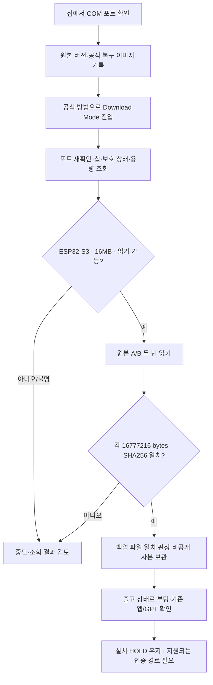

# K151 원본 백업·복구 준비 순서

2026-11-21 승인 후속: 무음 모델 진단에 이어 별도 보드 조회도 각1회 실행한 뒤,
검증한 전체 원본에서 추출한 **같은ota_1 범위만** 복구·독립 verify했다. 최신 보드
조회 후 표/OTA 세 시점 일치와 **사용자의 얼굴/메뉴 복귀**까지 확인했다.
[최신 보드 조회·복구](validation/2026-11-21-k151-board-readback-live.md)를 우선한다.
전체16MB 복구를 시험한 것은 아니다.
서로 다른 C:/D: 물리 NVMe의 원본 사본 SHA도 확인했다.
[범위와 실물 기록](validation/2026-11-21-k151-silent-resource-bench.md)을 함께 본다.
아래의 복구 쓰기/별도 저장장치 미확인은 이 승인 실행 전의 이력이다.

2026-11-20 Windows 후속에서 기존 A/B 길이·SHA·표 MD5를 로컬 재검증했다.
과거 OTA 기록은seq1/seq2 VALID로ota_1 선택 후보이며 현재 실행 슬롯/빈 여분을
입증하지 않는다. 최신 독립 경로의 [설치 전 offset·자산·복구 명령 초안](K151_NATIVE_INSTALL_PREP.ko.md)을
함께 따른다. 기존 백업을 장치에서 다시 읽거나 쓰지 않았다.

대상: 현재 출고 펌웨어와 StackChan World 앱으로 GPT 음성 대화를 사용 중인 K151,
Windows cmd, 기존 폴더 `%USERPROFILE%\stackchan-soak-24h`.
공식 자료 확인: 2026-11-17 UTC, USB 연결 후속 확인:2026-11-18(한국 시간).
사용자의 Windows에서 COM3/Espressif303A:1001, esptool5.6.0, 실제 ESP32-S3·보호 상태·16MB
조회와 원본 A/B 각16MB·SHA256 일치까지 사용자 출력으로 확인했다.
이후 정상 부팅·기존 앱/GPT 기능 복귀도 사용자 보고로 확인했다.
[진행 상태와 현장 근거](validation/2026-11-18-k151-usb-preflight.md) 참고.
백업 파일 일치는 실제 복구 쓰기 성공이나 커스텀 빌드의 공식 앱 호환성 판정과 구분한다.

## 먼저 알아야 할 호환성 판정

공식 저장소 기여자는 [인증 관련 답변](https://github.com/m5stack/StackChan/issues/134#issuecomment-6812198686)에서
공개 소스의 인증 함수는 대체 구현이고, 제품 펌웨어의 인증 구현은 저장소에 없으며,
SDKCONFIG 설정으로 활성화할 수 없다고 설명했다. 공식 연동을 유지하는 커스텀 빌드용
인증 컴포넌트·설정 절차도 공개되어 있지 않다고 답했다.

따라서 **현재 관찰 펌웨어를 설치하면서 공식 앱 연동을 유지한다는 조건은 미충족**이다.
백업 파일이 생겨도 이 조건이 해결되지는 않는다. 현재 출고 펌웨어와 정상 GPT 대화를
유지하며, 아래 단계는 원본 보존·복구 준비까지만 수행한다. 앱을 포기하거나 backend를
바꾸는 결정, 펌웨어 설치·복구 쓰기는 별도 작업이다.



## 1. 집에 돌아오면 이 명령부터

아직 RST를 누르지 말고 **cmd**에 아래 한 줄만 입력한다. 장치 이름과 COM 포트를
조회하며, 직렬 포트를 열거나 로봇에 명령을 보내지 않는다.

```cmd
powershell.exe -NoProfile -Command "Get-PnpDevice -PresentOnly -Class Ports | Select-Object Status,FriendlyName | Format-Table -AutoSize"
```

결과의 `Status`, `FriendlyName`, `COM번호`만 확인한다. 여러 포트가 있으면 이름만으로
선택하지 않는다. 케이블 연결 전후 차이로 확인하며, 본체가 움직일 공간과 케이블 여유를
확보한다. 공식 안내는 **베이스 USB-C 포트**를 권장한다. 두 USB-C 모두 데이터 전송을
지원한다. 현재 연결이 이미 베이스 포트라면 확인을 위해 무작정 옮길 필요는 없다.
포트가 없거나 조회 오류가 나면 그 결과부터 확인하고, 아직 아래 장치 명령으로 넘어가지 않는다.

이후 명령의 **COM_CONFIRMED는 확인한 포트로 바꿀 자리표시자**다.
이번 사용자 PC의 COM7은 Bluetooth 포트이므로 USB 대상으로 사용하지 않는다.
일반 부팅에서는 COM3을 확인했으며 실제 사용할 포트는 단계마다 다시 확인한다.
Download Mode에 들어가면 포트 번호가 달라질 수 있으므로 다시 조회한다.

## 2. 로컬 보관 폴더와 공식 복구 이미지 준비

1. 본체 펌웨어 버전, 앱 버전, 정상 GPT 응답 여부를 로컬에 기록한다. 현재까지 받은
   기록은 본체V1.6.2/앱v1.2.12이며 오늘 재확인한 값은 아니다.
2. [공식 제품 매뉴얼의 Restore Factory Firmware](https://docs.m5stack.com/en/StackChan#restore-factory-firmware)에
   연결된 Windows M5Burner를 받는다. 도구에서 `StackChan` 검색 → `Only Official` →
   실제 K151에 맞는 항목의 게시자·대상·버전을 확인 → **Download만** 한다.
3. 다운로드 항목/버전/URL과 파일 SHA256을 로컬에 남긴다. 자체 해시는 같은 파일임을
   추적하는 값이며 제조사 서명·공개 체크섬을 확인했다는 의미는 아니다.
   도구에서 실제 이미지 파일 경로를 확인할 수 없다면 파일/해시 미확인으로 남긴다.
   다운로드 버튼을 눌렀다는 사실만으로 복구 이미지 검증을 완료 처리하지 않는다.
4. 이 단계에서 `Burn`, `Start`, `Unbind & Reset`, 공장 초기화나 다른 보드 데모를
   실행하지 않는다. 매뉴얼의 복구 쓰기 절차는 실제 복구가 필요한 때의 별도 작업이다.
5. 다음 새 폴더를 만든다. **이미 존재한다면 중단하고 새 번호의 폴더를 정한 뒤
   이후 경로도 모두 일치시킨다.** 기존 원본 파일 위에 다시 읽지 않는다.

```cmd
mkdir "%USERPROFILE%\stackchan-soak-24h\.local\device-backup\k151-original-01"
```

`.local`은 이 저장소에서 Git 제외 대상이다. 전체 flash에는 Wi-Fi/계정 관련 설정 등이
들어갈 수 있으므로 원본 `.bin`과 전체 직렬 로그는 채팅·GitHub·공개 공유에 올리지 않는다.
사용자 노트북에 보관하고, 검증 후 비공개 사본을 하나 더 만든다.

## 3. 도구 버전 확인 — 로봇을 조작하지 않는 단계

별도 uv 도구 환경을 사용하며 프로젝트의 Python 의존성/lock은 바꾸지 않는다.
아래는 버전 확인이며 아직 직렬 포트를 열지 않는다.

```cmd
"%USERPROFILE%\.local\bin\uv.exe" tool run --from esptool==5.6.0 esptool version
```

정상 버전은 `5.6.0`이다. `uv.exe`나 설치 과정 오류가 나면 출력부터 확인한다.
명령 여러 개를 한 줄에 이어 붙이지 않고, 매번 cmd 프롬프트가 돌아온 뒤 다음 줄을 실행한다.

## 4. Download Mode 진입과 대상 확인

이 단계는 **현재 대화를 중단하고 로봇을 부트로더 상태로 바꾼다.** 진행할 때 로봇을
평평한 곳에 두고 회전부·케이블에 손이나 물건이 걸리지 않게 한다.

1. 공식 매뉴얼에 따라 바닥 microSD 옆 **RST를 약3초** 누른다.
2. 옆 LED가 초록색으로 켜지면 놓는다. 매뉴얼은 놓은 뒤 LED가 꺼지며 Download Mode에
   들어간다고 설명한다. 왼쪽 전원 버튼과 혼동하지 않는다.
3. 1번의 Windows 포트 조회를 다시 실행하고 새로 나타난 정확한 포트를 확인한다.
4. USB 포트가 다시 확인되면 아래 두 명령을 실제 포트로 바꿔 **한 번에 하나씩** 실행한다.

```cmd
"%USERPROFILE%\.local\bin\uv.exe" tool run --from esptool==5.6.0 esptool --chip esp32s3 --port COM_CONFIRMED --before no-reset --after no-reset --no-stub --connect-attempts 1 get-security-info
```

```cmd
"%USERPROFILE%\.local\bin\uv.exe" tool run --from esptool==5.6.0 esptool --chip esp32s3 --port COM_CONFIRMED --before no-reset --after no-reset --no-stub --connect-attempts 1 flash-id
```

기본 조회·백업의 `--before no-reset`/`--after no-reset`는 도구가 명시적으로 전후 리셋을 수행하지 않게 하는
옵션이며, USB 드라이버의 포트 열기 동작까지 무변화라고 보장하지 않는다.
`--no-stub`는 RAM 보조 프로그램도 올리지 않고 ROM 부트로더를 사용하는 선택이다.
원본 읽기에 충분하지 않은 보호/드라이버 상태이면 오류로 중단하며 우회하지 않는다.

**다음으로 넘어갈 조건:** ESP32-S3, `Detected flash size: 16MB`,
`Secure Boot: Disabled`, `Flash Encryption: Disabled`, 추가 다운로드/읽기 제한 없음.
하나라도 Enabled/불명, 다른 칩·용량, 연결 실패·읽기 제한이면 여기서 멈춘다.
보호 설정이나 eFuse를 바꾸지 않는다. 전체 로그 대신 칩 종류·용량·보호 상태·고정 오류
요지만 검토하고, MAC/시리얼 전체는 가린다.

### USB 포트 소실 또는 Write timeout이 날 때

Bluetooth 포트만 보이면 칩 명령을 실행하지 않고 Espressif 장치를 다시 조회한다.

```cmd
powershell.exe -NoProfile -Command "Get-PnpDevice -PresentOnly | Where-Object InstanceId -Match 'VID_303A' | Select-Object Status,Class,FriendlyName | Format-Table -AutoSize"
```

2026-11-18 현장에서는 COM3이 다시 보여도 no-reset 조회가 Write timeout이었고,
USB 재연결 후 같은 오류가 재현됐다. 공식 매뉴얼은 Download Mode의 녹색 LED를
설명하지만 실제 관측은 화면 꺼짐·녹색 LED 계속 켜짐이었다. LED·PnP 표시만으로
ROM 접속 성공을 가정하지 않는다.

**K151의 Espressif303A:1001 USB Serial/JTAG와 실제 포트가 확인된 경우** esptool의
USB 전용 리셋으로 보호 조회를 한 번 시도할 수 있다. 이 명령은 칩 리셋을 수행하며
flash를 쓰거나 지우지 않는다. 현재 대화는 멈추고 로봇을 평평한 곳에 둔다.

```cmd
"%USERPROFILE%\.local\bin\uv.exe" tool run --from esptool==5.6.0 esptool --chip esp32s3 --port COM_CONFIRMED --before usb-reset --after no-reset --no-stub --connect-attempts 1 get-security-info
```

해당 현장에서는 이 방식으로 ROM 보호 조회가 성공했고, 이어 no-reset flash-id도
성공했다. 다른 장치·보호 상태에서의 성공을 보장하거나 정확한 과거 timeout 원인을
확정한 결과는 아니다. 실패가 계속되면 반복·드라이버 교체로 밀어붙이지 않고 중단한다.
성공한 뒤에는 같은 ROM 상태를 유지하고 기본 no-reset 명령으로 이어간다.

## 5. 동일한 Download Mode에서 원본 전체를 두 번 읽기

아래는 4번 조건과 **실제 COM 포트/새 폴더**를 확인한 뒤에만 사용하는 명령이다.
ROM 방식은 느릴 수 있다. 예상 시간을 약속하지 않으며 완료 전 창을 닫지 않는다.

```cmd
"%USERPROFILE%\.local\bin\uv.exe" tool run --from esptool==5.6.0 esptool --chip esp32s3 --port COM_CONFIRMED --before no-reset --after no-reset --no-stub --connect-attempts 1 read-flash --flash-size 16MB 0x0 0x1000000 "%USERPROFILE%\stackchan-soak-24h\.local\device-backup\k151-original-01\factory-a.bin"
```

첫 읽기가 성공해 프롬프트가 돌아오면 **기기를 재부팅하거나 앱을 실행하지 않은 상태로**
두 번째 파일에 읽는다. 중간 부팅으로 NVS가 바뀌면 두 파일이 달라질 수 있다.

```cmd
"%USERPROFILE%\.local\bin\uv.exe" tool run --from esptool==5.6.0 esptool --chip esp32s3 --port COM_CONFIRMED --before no-reset --after no-reset --no-stub --connect-attempts 1 read-flash --flash-size 16MB 0x0 0x1000000 "%USERPROFILE%\stackchan-soak-24h\.local\device-backup\k151-original-01\factory-b.bin"
```

이 과정에서 flash 지우기/쓰기를 수행하는 명령은 사용하지 않는다. 읽기 실패·부분 파일은
유효한 원본으로 취급하지 않으며, 덮어쓰기 대신 실패 기록을 남기고 원인을 확인한다.

## 6. 길이와 SHA256 확인

먼저 두 파일 모두 정확히 **16,777,216 bytes**인지 확인한다.

```cmd
powershell.exe -NoProfile -Command "Get-ChildItem -LiteralPath (Join-Path $env:USERPROFILE 'stackchan-soak-24h\.local\device-backup\k151-original-01') -Filter 'factory-*.bin' | Select-Object Name,Length | Format-Table -AutoSize"
```

두 SHA256이 같은지 확인한다.

```cmd
powershell.exe -NoProfile -Command "Get-ChildItem -LiteralPath (Join-Path $env:USERPROFILE 'stackchan-soak-24h\.local\device-backup\k151-original-01') -Filter 'factory-*.bin' | Get-FileHash -Algorithm SHA256 | Format-List Hash,Path"
```

파일 두 개·각 길이·해시 일치가 모두 확인되면 **백업 파일 일치 PASS**다.
**복구 성공 PASS는 아니다.** 중단 여부나 hash 불일치는 그대로 FAIL/HOLD로 남긴다.
다른 비공개 저장장치에 사본을 복사한 뒤 그 사본의 해시도 원본과 비교한다.

2026-11-18 현장에서는 별도 날짜 폴더 `k151-original-20261118-01`의 A/B가
각16,777,216바이트·동일 SHA256으로 확인됐다. 원본은 공개하지 않았으며,
[백업 메타데이터](validation/2026-11-18-k151-original-backup.json)에 확인 범위를 남겼다.

## 7. 출고 상태로 돌아와 기본 연결 확인

이제 공식 매뉴얼의 RST **한 번 누르기**로 재부팅한다. 모터가 움직일 수 있으므로
케이블과 주변을 확인한다. USB만 뽑아도 내장 배터리 때문에 꺼지지 않을 수 있다.

본체 화면 → 같은 펌웨어 버전 → 기존 StackChan World 연결 → 기존 GPT 음성 답변을
확인한다. 재페어링·Unbind·업데이트를 요구하면 임의로 진행하지 않고 메시지만 기록한다.
아직 새 관찰 펌웨어를 넣지 않았으므로 USB 관찰 도구는 실행하지 않는다.

2026-11-18 현장에서는 PC GPT를 먼저 준비한 뒤 짧은 RST 재부팅과 기존 앱·성공 표시·
음성 확인 요청에 사용자가 “잘된다”고 응답했다. 정상 복귀 PASS의 근거이며,
실제 복구 쓰기를 시험한 결과는 아니다. 별도 저장장치 사본은 아직 확인하지 않았다.

## 8. 구체적인 복구 경로와 남은 조건

- **원본 복구 후보:** 같은 장치에서 읽고 검증한 전체16MB를 해당 장치 flash 시작 주소
  `0x0`부터 되돌리는 경로다. 부분 앱 이미지나 다른 장치의 원본으로 대신하지 않는다.
  정확한 대상·파일·현재 보호 상태와 쓰기 옵션을 다시 검토하고 승인받은 뒤 수행한다.
- **공식 펌웨어 복구 후보:** 매뉴얼의 M5Burner → StackChan/Only Official → 해당 이미지
  → 확인한 포트의 복구 절차다. 최신 공식 이미지가 기존 NVS·보정·계정·대화까지 같은
  상태로 되돌린다는 보장은 없다. 원본 전체 복구와 동등하게 취급하지 않는다.
- **복구 범위 밖:** ESP32 flash 파일은 eFuse, 휴대폰/서버 데이터, 외부 컨트롤러·서보의
  별도 저장장치까지 백업하지 않는다. 앱 인증 구현을 새 소스 빌드에 제공하지도 않는다.
- **실제 복구 검증:** 아직 하지 않았다. 현재 정상 장치에 쓰기를 하면서 시험하지 않는다.
  복구할 상황이 생기면 구체적인 파일·대상·절차부터 확정한다.

기록할 항목은 실제 포트(로컬), 전후 펌웨어/앱 상태, 도구 버전, 칩/용량/보호 상태,
A/B 길이·SHA256 일치, 비공개 사본 확인, 공식 복구 이미지 출처/버전/해시,
`실제 복구 미실행`, `커스텀 빌드 공식 앱 인증 HOLD`다. 원본이나 인증값을 추출·공개하지 않는다.

세부 근거는 [호환성 검토 기록](validation/2026-11-17-k151-recovery-compatibility.md),
관찰 확장은 [USB 관찰 설명서](USB_OBSERVER.ko.md)를 참고한다.
