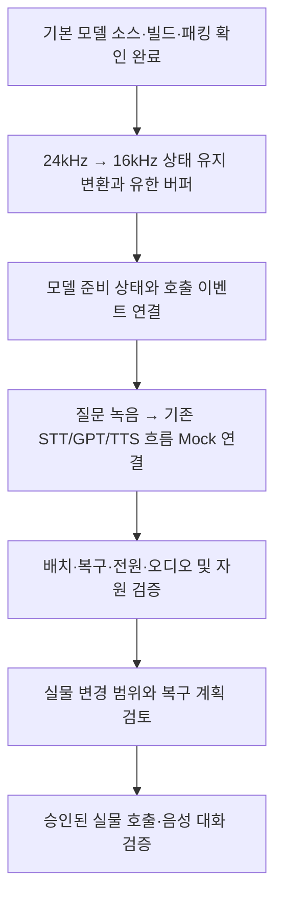

# K151 기본 호출어 → 독립 GPT 대화 진행 상태

2026-11-20 / Asia/Seoul. 기본 호출어 지원 검증을 먼저 진행하라는 사용자의 최신 선택에 따른다. 기존 “조수” 도구와 자료는 보존하며, 현재 작업 우선순위는 **Hi StackChan → 로봇 자체 GPT 대화** 경로다.

## 지금 확인한 결과

공식 StackChan 고정 소스는 ESP-IDF6.1 및 ESP-SR2.4.7의 `wn9l_histackchan_tts3`를 선택한다. 같은 버전으로 기존 K151 HOLD 앱의 임시 사본에 WakeNet API 참조와 모델 묶음을 추가해 **실제 ESP32-S3 컴파일/링크/모델 패킹 PASS**를 확인했다.

| 항목 | 실제 관측 |
|---|---|
| 선택 모델 | wn9l_histackchan_tts3 / Hi,Stack Chan / DET_MODE_90 API 참조 |
| 모델 묶음 | 292,607bytes, 모델1개·파일3개 및 각 SHA256 검증 |
| 검증용 HOLD 앱 bin | 334,688bytes (모든 음성 기능을 실행하는 최종 앱의 크기가 아님) |
| 정적 DIRAM | 65,482bytes (동적 heap/PSRAM 잔여량이 아님) |
| 공식 입력 규격 | 16kHz·모노·signed PCM16 |
| 기존 K151 경로 | 24kHz mic/reference 입력에서 모노 추출 |

원본 모델 파일 합계는292,447bytes이며 묶음 header160bytes가 더해진다. 디버그 ELF8,103,120bytes를 flash 점유량이나 RAM 요구량으로 계산하지 않는다. [기계 판독 증거](validation/2026-11-20-k151-builtin-wakenet-preflight.json)와 [기술 기록](validation/2026-11-20-k151-builtin-wakenet-preflight.md)을 참고한다.

## 다음 연결 순서

1. **입력 변환:** 기존 질문/출력은24kHz로 유지하고 WakeNet에 전달하는 스트림만16kHz로 변환한다. 매 블록마다 FIR 상태를 새로 만들지 않는다. 실제 model getter로 chunk 크기/채널/샘플레이트를 확인하고 유한 버퍼로 모은다.
2. **호출 경로:** 기성 모델 준비 여부를 개인 SWK1 등록 여부와 구분한다. STOP·동의·스피커 재생 차단과 session epoch를 유지하며 호출 이벤트 뒤 질문 대기로 전환한다. 기본 모델 경로는 개인 음성 등록을 요구하지 않는 방향이다.
3. **GPT 연결:** 기존 bounded 질문 캡처와 STT/GPT/TTS·재생 완료 후 대기 복귀를 연결하고 먼저 Mock으로 검증한다. 지금의 MCP+PC GPT 성공은 이 독립 경로의 완료 증거가 아니다.
4. **실물 전 준비:** model 저장 위치/무결성, 실제 활성 OTA와 복구 대상,8MB PSRAM/내부 heap·지연, 마이크·스피커 전원과 STOP 동작을 확인한다. 모델과 UI/질문/TLS/TTS가 함께 실행될 때의 자원량은 정적 빌드 크기로 대신하지 않는다.

## 현재 실물에서 할 일

기존 출고 펌웨어의 AI Agent 얼굴 화면에서 **“Hi StackChan(하이 스택챈)” 호출 반응**을 확인해 알려준다. 이 결과는 출고 펌웨어의 동작 관측이며 개발 이미지의 인식 성능과 구분한다. 기존 “조수” 등록을 같은 설정으로 반복할 필요는 없다.

현재 검증용 모델은 시작되지 않았다. 실제 마이크 인식률·오탐·처리 지연·동적 메모리와 로봇 단독 GPT 한 턴은 미검증이다. 제품 실행 코드와 app_main은 기존 HOLD를 유지한다. 임시 모델 파티션은 공장 배치와 달라 실물 설치 대상으로 사용할 수 없다. 이번에는 실제 기기/COM3·flash/NVS/OTA/모터·유료 API·음성 전송을 실행하지 않았다.
